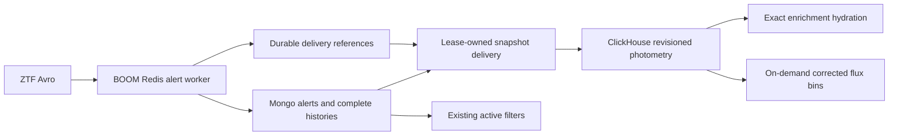

# Proposed BOOM photometry mirror

Keep MongoDB authoritative and retain its complete histories. Add ClickHouse as
an opt-in, revisioned photometry mirror, initially for experiments and internal
history/bin reads. The captured replay supports compatibility; it also shows a
delivery bottleneck that must be addressed before a production rollout.

## What the supplied capture establishes

The 10,000 unchanged public-program packets contain 10,000 distinct alerts for
9,755 objects and produce 777,058 current photometry records. Input is paced at
10 ms in filename order. These are real packet contents with a synthetic
schedule, not recorded broker arrivals or an Argus capacity test. Median history
size is 80 records (p95 100; maximum 144), spanning about 30 days. There are
135,480 detections, 377,750 upper limits and 263,828 forced measurements. Only
245 alerts revisit an object already in this capture; sustained repeated-object
write cost needs a longer capture.

| Initial execution | Mongo baseline | Healthy shadow |
| --- | ---: | ---: |
| Ingestion elapsed | 115.40 s | 139.04 s |
| Ingestion packets/s | 86.66 | 71.92 |
| Time to converge | 115.84 s | 526.26 s |
| Converged packets/s | 86.33 | 19.00 |
| Populated-history read p50 | 3.83 ms | 12.88 ms |
| Populated-history read p95 | 5.55 ms | 26.19 ms |

One native alert worker runs with four concurrent shadow deliveries, 64 reference
claims per poll and a one-second poll interval. Ingestion elapsed increases
20.5%; peak sampled pending age reaches 521 seconds. Model inference and final
validation run after the timing. Baseline-first ordering, caches, concurrent
background work, synthetic pacing and this single-machine setup limit causal
and capacity conclusions. In particular, the shadow does not keep up with the
offered 100 packets/s schedule in this configuration.

All 9,755 healthy-phase histories match Mongo structurally and in derived
photometry features. Validation reads the sink without repairing it. All 32
sampled enrichment pairs match exact typed inputs, model tensor hashes,
properties, ACAI/BTSbot scores and AppleCiDER outputs/embeddings. This sample
covers 32 AppleCiDER-eligible alerts. It does not establish cross-survey/catalog
context coverage or every production model path.

The initial execution then stopped during the outage phase because the Docker
VM exhausted its disk, causing MongoDB to terminate. Its overall result is
**FAIL**; only the completed baseline and healthy phases above are used. Unused
Docker images/build cache were removed. The harness now drops each successfully
validated disposable Mongo database before starting the next phase. Recovery
is measured in a separate execution and must not be presented as a continuous
three-phase pass. The failed initial controller did not append its final
source/binary provenance, so those timings remain exploratory and must be
reproduced before rollout sizing. New controllers save provenance before work
starts, including failed runs.

## Independent outage recovery: PASS

With the same 10,000 unchanged packets, the sink returned HTTP 503 throughout
source ingestion. After restoring delivery, the same worker drained **10,000
durable references in 515.54 seconds (19.40 references/s)**, with no new input.
All 9,755 reconstructed histories matched without sink repair. All 32 sampled
ACAI/BTSbot and 32 AppleCiDER pairs matched, as did **96 Mongo-history/bin
comparisons** across 15-minute, hourly and daily cadences.

This independent execution used clean BOOM commit
`7ee77a5f3527d07c4a31c67f01e857415ec35a57`, ClickHouse 26.11.1.120 and the recorded
CPU model/binary hashes. It establishes eventual recovery for this outage, not
headroom while new traffic continues. Healthy throughput and baseline overhead
were not remeasured in this execution.

## Storage and write cost

The independent recovery run records the complete normalized payload, not the
old synthetic seven-column representation:

| Measured final snapshot | Bytes/count |
| --- | ---: |
| Current logical records | 777,058 |
| Physical records at part snapshot | 788,419 |
| Compressed columns from active parts | 86,228,653 |
| Active parts on disk | 86,388,217 |
| Logical payload string bytes through `FINAL` | 389,752,423 |
| Payload compressed bytes in later column snapshot | 72,382,135 |
| All compressed bytes in later column snapshot | 82,028,947 |

That is about **111 compressed bytes per current record**, including physical
versions present at measurement. Payload accounts for **88.2%** of the later
column snapshot. These are separate live snapshots while merges continue;
column/part totals need not match. The initial healthy snapshot was also about
111 bytes per record (86,136,491 compressed bytes). These small-corpus figures
are additional mirror footprint, not production storage projections or
retention savings. The old synthetic 3.43 bytes/point is inapplicable.

Mongo aux histories remain intact: 283,923,109 logical BSON bytes and
111,288,320 allocated collection bytes in this independent run. Mongo
database totals additionally include alerts, cutouts, indexes, outbox and parity
state. Allocation/compression differ by representation and checkpoint state;
there is no demonstrated saving from deleting histories.

Dedicated-server counters record 796,678 inserted rows,
191,003,180 compressed insert-data bytes written,
and 27,205,721 rows read for background merges
(15,228,500,305 uncompressed merge-input bytes). The
file-descriptor counter reaches 3,322,166,875 bytes,
including data and metadata. These counters measure different layers; they are
not a physical SSD write-amplification measurement. Small inserts and merge work
are priorities alongside payload compression.

## Binning without duplicate sums

The native `Store::bins(object_id, cadence_seconds)` computes fixed UTC bins
from deduplicated `FINAL` normalized columns, without parsing payloads. It keeps
programs, bands and detection/forced/upper-limit kinds separate. Measured flux
uses inverse-variance weights and uncertainty; negative flux is valid. Upper
limits and missing flux remain in record counts and contribute no weighted
flux. This is a measurement aggregation, with no additional quality-mask policy.

CI checks the actual SQL against an independent reference, including duplicate
snapshots, corrections followed by old replay, missing values, negative forced
flux, multiple programs/bands and bucket boundaries. Captured replay samples
also compare 15-minute, hourly and daily bins against Mongo source histories.
Only bin sums permit floating-point accumulation tolerance; raw-history/model
parity remains exact.

There is no persisted bin cache yet. If query cost justifies one, key it by
object, source revision, cadence and quality policy, and rebuild affected bins
on accepted corrections or late data. Summing incoming packet histories in an
incremental materialized view would count overlaps repeatedly.

## The filter boundary controls the architecture

The supplied deployed export has 96 active ZTF filters. Of these, 63 directly
reference history: 62 detection histories, 21 forced histories and 10 upper-limit
histories (counts overlap). The other 33 have no detected direct history
reference; that is not approval for truncation. Derived features, dynamic access,
cross-survey context, lookups and actual predicate semantics still require review.
See the [anonymized inventory](evidence/ztf-active-filter-inventory.json).

Keep existing Mongo filter execution and program authorization. Do not choose a
Mongo retention window from this dependency count. Any future ClickHouse filter
path must preserve program permissions and compare actual deployed filter
outputs on representative histories before switching.

## Next implementation and acceptance gates

1. Batch/coalesce accepted delivery references while retaining per-reference
   leases, acknowledgements and revision ordering. Repeat this exact capture
   and fault suite to quantify ingestion overhead, convergence and merge writes.
   Then compare payload codecs/representations while preserving exact readback;
   the dominant column deserves its own compression and serialization profile.
2. Define an operational arrival-rate target, allowable lag and outage duration;
   measure concurrent arrival and recovery headroom at that target. Add longer
   captures with repeated objects, private-program separation and realistic
   cross-survey/catalog context.
3. Execute deployed filters on both complete and proposed bounded histories;
   review every changed result and computed-feature dependency before proposing
   retention. Keep complete histories until this is resolved.
4. Specify durable backfill, tombstones/identity changes, schema migration,
   ownership/failover and program authorization. Exercise Mongo replica-set and
   process/container failures before any production cutover.

The runnable method is in [BENCHMARK.md](BENCHMARK.md). The
[verified GitHub implementation run](https://github.com/boom-astro/boom-clickhouse/actions/runs/39068287687)
passes all three jobs and publishes the fixture-derived recovery/parity/binning
demonstrations; the captured corpus and
private filter export remain outside git. The [aggregate captured evidence](evidence/ztf-10k-replay.json) records both
executions, source/model hashes, per-column sizes, counters and raw report checksums.
Individual alert IDs, packet paths and private filter names/pipelines are omitted.
