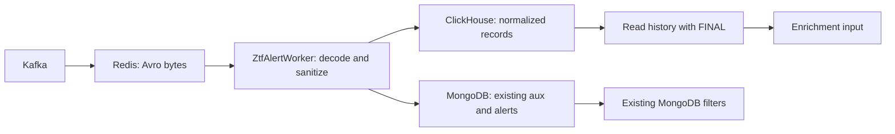

# BOOM ZTF integration example

This is a runnable Rust shadow store for the normalized photometry BOOM already
produces. It includes a small HTTP client, a separate ClickHouse table, a fixture,
and tests against a disposable ClickHouse server. The companion
[`clickhouse_shadow` example](https://github.com/mcoughlin/boom/blob/87c341bfb8180008ececac8aed09f54a282a07ab/examples/clickhouse_shadow.rs) in the
sibling BOOM checkout uses BOOM's actual `ZtfPrvCandidate` and `ZtfForcedPhot`
types for both serialization and readback. Keep these two checkouts as siblings;
the BOOM example includes the adapter module by relative path and uses existing
BOOM dependencies. Its `clickhouse-example` feature keeps default BOOM builds
independent of the sibling checkout. The basic example is a smoke test. The
native worker proposal below adds a separate opt-in path, disabled by default.

## Native worker proposal and real-alert replay

The companion BOOM proposal at `87c341b` includes a [native implementation](https://github.com/mcoughlin/boom/blob/87c341bfb8180008ececac8aed09f54a282a07ab/src/photometry/mod.rs)
and [architecture and recovery contract](https://github.com/mcoughlin/boom/blob/87c341bfb8180008ececac8aed09f54a282a07ab/docs/photometry-shadow.md).
It writes durable references before Mongo ingestion, drains accepted source
snapshots with expiring leases, compares complete records and photometry
features, and reports lag. MongoDB retains its current authority and histories.

The replay runs BOOM's actual Redis alert worker with the repository's two real
Avro fixtures plus labeled late-history derivatives. A paced healthy phase
overlaps ingestion, shadow delivery, and history reads. Failure scenarios cover
an incomplete Mongo source, a ClickHouse outage after Redis acknowledgement,
idle-worker restart, an expired delivery lease after a sink write, accepted
source metadata corrections, and the existing-alert shortcut.

Use fresh dedicated development services; the replay requires an empty Redis.
From `boom-clickhouse`, set `BOOM_SOURCE` to your proposal checkout:

```sh
export BOOM_SOURCE="/path/to/boom-branches/clickhouse/boom"
cargo build --manifest-path "$BOOM_SOURCE/Cargo.toml" --example photometry_shadow_replay
docker compose -p boom-shadow-replay -f examples/boom/compose.proposal.yaml up -d --wait
DEMO_ARTIFACTS="$PWD/results/proposal" CH="$HOME/clickhouse" \
    python3 examples/boom/tests/proposal.py
docker compose -p boom-shadow-replay -f examples/boom/compose.proposal.yaml down -v
```

The controller starts and removes its own ClickHouse server, strips ambient
BOOM overrides, runs outside the checkout so `.env` is not loaded, and uses
isolated database names. The Rust driver rejects non-loopback connections and
shared/default database names. `BOOM_SOURCE`, `REPLAY_ADAPTER`,
`REPLAY_MONGO_PORT`, and `REPLAY_REDIS_PORT` override development paths/ports.

The artifact contains `demo.md`, `proposal.json`, JUnit results, worker output,
and server logs. It records exact parity differences, per-alert enrichment
input and photometry-property comparisons, observed request timings, concurrent
read samples, lag, and storage accounting for both stores. A retained
uncommitted-source reference is intentional and appears in the final lag.
These tiny, paced fixtures demonstrate correctness and recovery, not production
capacity. Model inference, host and cross-survey features, Kafka rebalance,
retention, deletes, and production failover remain outside this evidence.

The real fixtures exposed one-bit float changes in ordinary JSON parsing. Both
clients now use `float_roundtrip`, with a regression test for those values and
large integer measurement IDs. Exact record comparisons remain enabled.

The filter inventory accepts bare pipelines or exported BOOM filter documents
and selects only their active `fv` version. `REPLAY_FILTER_DIR` selects another
directory of JSON exports. For a read-only inventory without services:

```sh
cargo run --manifest-path ../boom/Cargo.toml --example photometry_filter_audit -- \
    ../boom/data/filters/fast.json active-filters-export.json
```

Dynamic field access and history references require review; the inventory never
automatically approves a bounded Mongo window.

## GitHub demonstration

The [integration workflow](../../.github/workflows/integration.yml) runs on pushes,
pull requests, and manual dispatch. The first job tests the adapter and prototype
schemas. The second checks out BOOM at commit
`1a39dcc3c403c6cc8533dfad862c1eac2c62a088`, installs the example from this
repository, and runs the same HTTP suite through BOOM's actual ZTF types.
A third job checks out the native worker proposal at `87c341b`, starts isolated
MongoDB and Redis services, and publishes the real-alert proposal report.
It does not require a corresponding BOOM PR, extra secrets, or production services.

Both jobs use ClickHouse **26.9.21.9 stable**, downloaded from the official release
and checked against a pinned SHA-256. Each run publishes a scenario table in the
GitHub job summary and a downloadable artifact containing `demo.md`, `results.json`,
`junit.xml`, example histories and bins, and server logs. Failed assertions fail
the job; reports and logs are uploaded on failure too. The canonical BOOM example
is [boom_example.rs](boom_example.rs); the copy in the BOOM checkout should match it.

## Run the complete isolated demonstration

From `boom-clickhouse`:

```sh
cargo test --manifest-path examples/boom/Cargo.toml
cargo build --manifest-path examples/boom/Cargo.toml
CH="$HOME/clickhouse" python3 examples/boom/tests/integration.py
```

The last command starts a temporary ClickHouse server on a random loopback HTTP
port, runs the actual Rust client against it, stops the server, and removes its
data. It needs permission to bind a local port and never opens `./chdata`, MongoDB,
Redis, or Kafka. Tested with ClickHouse 26.11.1.120.

The tests cover identical retries, expired retry tokens with merges disabled,
overlapping alert histories, late points,
explicit correction revisions followed by an older replay, private programs,
upper limits, null and negative flux, parameterized object IDs, full record
readback, and HTTP error propagation. The fixture's tiny flux values are synthetic
and are deliberately easy to check by hand; it is not a physically calibrated
alert packet.

## Try it against a development ClickHouse server

Use a dedicated development database that already exists. Credentials come only
from the environment:

```sh
export BOOM_CLICKHOUSE_URL=http://127.0.0.1:8123
export BOOM_CLICKHOUSE_DATABASE=boom_photometry_demo
export BOOM_CLICKHOUSE_USER=default
# Set BOOM_CLICKHOUSE_PASSWORD in your shell if required.

cargo run --manifest-path examples/boom/Cargo.toml -- init
cargo run --manifest-path examples/boom/Cargo.toml -- write examples/boom/fixture.json 1
cargo run --manifest-path examples/boom/Cargo.toml -- write examples/boom/fixture.json 1
cargo run --manifest-path examples/boom/Cargo.toml -- read ZTF_demo
cargo run --manifest-path examples/boom/Cargo.toml -- nightly ZTF_demo
```

The nightly result has one detection bin with `n_points=2`, `flux=18`, and
`flux_err=0.89442719`, plus a separate forced bin with `n_points=1`, `flux=-5`,
and `flux_err=2`. The upper limit remains in the returned history and contributes
to neither bin. Repeating the same write does not change these results.

Now run the companion example from `../boom` with the same environment:

```sh
cargo check --features clickhouse-example --example clickhouse_shadow
cargo run --features clickhouse-example --example clickhouse_shadow -- prepare ../boom-clickhouse/examples/boom/fixture.json 1
cargo run --features clickhouse-example --example clickhouse_shadow -- write ../boom-clickhouse/examples/boom/fixture.json 1
cargo run --features clickhouse-example --example clickhouse_shadow -- read ZTF_demo
```

After building that example, the HTTP suite can use the BOOM executable for
its writes and typed readback. From `boom-clickhouse`:

```sh
BOOM_ADAPTER="$PWD/../boom/target/debug/examples/clickhouse_shadow" \
    CH="$HOME/clickhouse" python3 examples/boom/tests/integration.py
```

`prepare` needs no server and prints JSONEachRow generated from BOOM's real
record types. `write` sends those records to the table initialized above. `read`
deserializes the stored records back into the same BOOM types. The smaller
standalone CLI accepts the serialized JSON representation, so it can iterate
without building BOOM's Kafka, inference, and catalog dependencies.

## Where it fits in BOOM



1. **Ingestion:** `src/alert/ztf.rs`, `ZtfAlertWorker::process_alert`, immediately
   after the three `sanitize_timeseries` calls and before `check_alert_exists`.
   The variables are `object_id`, `prv_candidates`, `prv_nondetections`, and
   `fp_hists`. `PreparedBatch::ztf` accepts these typed slices directly, exactly
   as the companion example does. Build `Store` once per worker, prepare a
   batch, and await `Store::insert`. Placing a required write before the
   existing-alert shortcut lets a retry repair a missing ClickHouse copy even
   when MongoDB already contains the alert. A service implementation also needs
   an `AlertError` variant, config, and retry/ack policy; those are not enabled
   by this example.
2. **Enrichment:** `src/enrichment/ztf.rs` currently uses MongoDB `$lookup` to
   obtain `prv_candidates`, `prv_nondetections`, and `fp_hists`. `Store::history`
   reconstructs these three arrays. A later experiment can hydrate that input
   from ClickHouse before deserializing the enrichment struct. The example
   demonstrates typed readback; it does not silently replace the lookup.
3. **Filters and APIs:** existing Mongo aggregation filters still run against
   MongoDB. Keep Mongo aux histories during this shadow experiment, compare
   histories and computed properties, and design the bounded-window/filter
   contract before removing arrays. This example therefore does not yet solve
   MongoDB's document-size limit. Preserve all existing authorization and
   programid checks when serving ClickHouse data; this adapter is an internal
   store and returns every program for the requested object.

BOOM's current Kafka consumer pushes payload bytes into Redis and marks offsets
there; the alert worker receives no Kafka offset envelope. A Kafka token is
therefore unavailable at this hook. The adapter hashes a canonical, sorted
batch into a stable token and retains its exact request body. An ambiguous
failure can be retried with the same `PreparedBatch`. The content token helps
with recent retries; correctness of the reads comes from the measurement key,
explicit revision, and `FINAL`, including after the token window expires.

## Data and consistency contract

- **Identity:** this ZTF-only table uses the string object ID plus kind, band,
  JD, and programid. Detections and forced measurements at the same epoch stay
  separate, as do different programs. This follows BOOM's epoch-based history
  model; a survey allowing multiple independent measurements at the same key
  needs an exposure/measurement ID. Add survey identity before sharing the table
  with other surveys.
- **Units and fields:** copy BOOM's normalized `psfFlux` and `psfFluxErr`
  verbatim. Do not repeat the magnitude or zero-point conversion. Preserve the
  entire serialized record as `payload`, including `forcediffimflux`,
  `forcediffimfluxunc`, `magzpsci`, coordinates, limiting magnitude, and
  programid. The forced-photometry enrichment path currently still reads its
  original flux fields. A full payload costs more space than the benchmark's
  seven-column schema; its compression results do not apply to this table.
- **Revisions:** the CLI argument is an authoritative, monotonically increasing
  source revision, retained across retries. Use a fixed revision only for
  immutable records. Never derive it from retry time, and do not assume Kafka
  offsets from different partitions or candids define a per-measurement order.
  A correction needs a higher revision; differing payloads at the same key and
  revision are unsupported. A revision convention is still required before
  enabling corrections in a real worker.
- **Bins:** `NIGHTLY_SQL` reads `FINAL` first and aggregates on demand, by UTC
  day, kind, band, and programid. It excludes upper limits and missing flux.
  Overlapping histories and older replays cannot multiply a contribution.
  This trades aggregate read speed for a simpler correctness contract; it is
  not the original incremental materialized view. Flags do not exclude points.
- **Dual writes:** MongoDB, ClickHouse, and Redis have no shared transaction.
  A required shadow write must fail processing on a ClickHouse error and be
  retried before the job is acknowledged. A best-effort shadow needs a durable
  repair queue and lag monitoring. The example does not alter BOOM's current
  failure handling or claim exactly-once delivery. Currently
  `handle_process_result` logs processing errors as "skipping" and leaves the
  temporary-queue entry; it does not schedule an immediate ClickHouse retry.
  Merely adding a fallible write does not supply a complete retry policy.
  A real cutover requires
  reconciliation, a BOOM data task for backfill, and tests of worker crashes
  between each write and queue transition.

The client uses [typed HTTP query parameters](https://clickhouse.com/docs/interfaces/http)
for object IDs, synchronous inserts, finite timeouts, and buffered HTTP responses
so late server errors are reported as failures. `CREATE IF NOT EXISTS` is setup
for a fresh demo table, not a migration of existing definitions.
